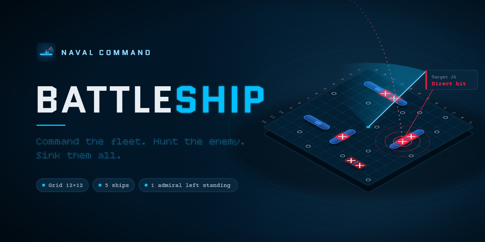
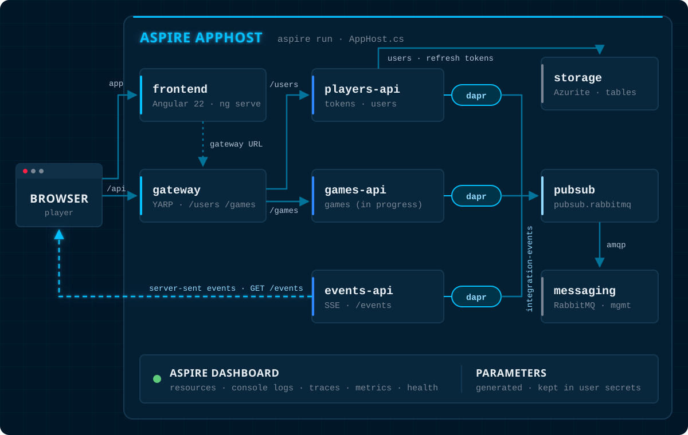
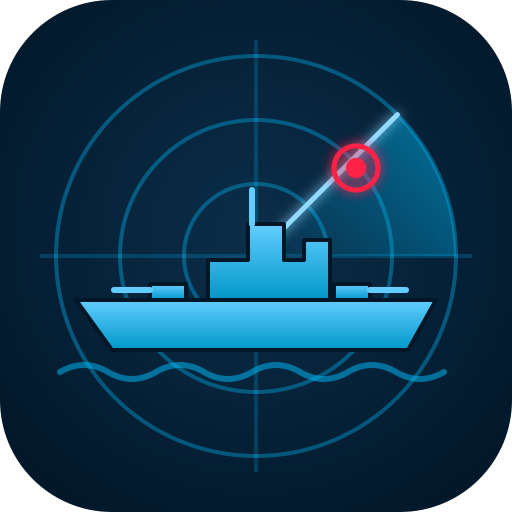

<div align="center">



<h3>A real-time, two-player Battleship game, and a working tour of <a href="https://aspire.dev">Aspire</a>.</h3>

<p>
<a href="https://dotnet.microsoft.com/download/dotnet/10.0"></a>
<a href="https://aspire.dev"></a>
<a href="https://dapr.io"></a>
<a href="https://www.rabbitmq.com"></a>
<a href="https://angular.dev"></a>
<a href="https://github.com/hexmasternl/battleship/actions/workflows/ci.yml"></a>
<a href="LICENSE"></a>
</p>

<p>
<a href="#-quick-start"><b>Quick start</b></a> &nbsp;·&nbsp;
<a href="#what-this-demo-shows-about-aspire"><b>Aspire tour</b></a> &nbsp;·&nbsp;
<a href="#architecture"><b>Architecture</b></a> &nbsp;·&nbsp;
<a href="#services"><b>Services</b></a> &nbsp;·&nbsp;
<a href="#how-we-work"><b>How we work</b></a> &nbsp;·&nbsp;
<a href="CONTRIBUTING.md"><b>Contributing</b></a> &nbsp;·&nbsp;
<a href="docs/design-system.md"><b>Design system</b></a>
</p>

</div>

---

## Briefing

Two admirals, two hidden fleets, one 12×12 grid each. Players join without registering, place
five ships and take turns firing until only one fleet is still afloat. Every shot reaches the
opponent's screen in real time.

The game is also a **reference project for building distributed .NET apps with Aspire**. One
`aspire run` starts the whole thing:

- an Angular frontend
- three ASP.NET Core APIs, each with a Dapr sidecar
- a YARP gateway
- a RabbitMQ broker
- an Azure Storage emulator
- the Aspire dashboard, which shows all of it

You don't need a cloud account, a `docker-compose.yml`, or any connection string written by hand.

> [!NOTE]
> The game is playable end to end: create a game, share its code, place your fleet, take turns
> firing and see the result. Games without activity are cleaned up daily. Work continues in the
> open through [issues](https://github.com/hexmasternl/battleship/issues) and OpenSpec changes.

---

## ⚓ Quick start

### 1. Install the prerequisites

| Prerequisite | Why | Check |
|---|---|---|
| [Docker Desktop](https://www.docker.com/products/docker-desktop/) (running) | RabbitMQ and Azurite run as containers, and `dapr init` runs its own | `docker version` |
| [.NET 10 SDK](https://dotnet.microsoft.com/download/dotnet/10.0) | Builds and runs the services | `dotnet --version` |
| [Aspire CLI](https://aspire.dev/get-started/install-cli/) | Runs the AppHost and opens the dashboard | `aspire --version` |
| [Dapr CLI](https://docs.dapr.io/getting-started/install-dapr-cli/) | Starts the sidecars | `dapr --version` |
| [Node.js](https://nodejs.org) with npm | Runs the Angular dev server | `node --version` |

### 2. One-time setup

```shell
dapr init                              # downloads daprd, starts the placement and scheduler containers
cd src/Frontend && npm install && cd -  # frontend packages
```

> [!TIP]
> `dapr init` also starts Redis and Zipkin containers. This solution doesn't use them, and they
> don't conflict with the containers the AppHost starts.

### 3. Launch

```shell
cd src/Aspire/HexMaster.Battleship.Aspire
aspire run
```

The CLI builds the solution, starts the AppHost, prints the dashboard URL and opens it in your
browser. When every resource is **Running**, open the `frontend` endpoint and play.

To stop, press `Ctrl+C`, or run `aspire stop` from the same folder.

> [!IMPORTANT]
> If the AppHost stops right away with a message about Dapr, either the Dapr CLI is missing or
> `dapr init` hasn't been run on this machine. The message names the missing step. That
> fail-fast check is [`DaprPrerequisites.cs`](src/Aspire/HexMaster.Battleship.Aspire/HexMaster.Battleship.Aspire.AppHost/DaprPrerequisites.cs).

---

## What this demo shows about Aspire

Everything below is in a single file:
[`AppHost.cs`](src/Aspire/HexMaster.Battleship.Aspire/HexMaster.Battleship.Aspire.AppHost/AppHost.cs).
Read it top to bottom. It is short and every block has a comment.

| Aspire concept | How Battleship uses it |
|---|---|
| **Projects as resources** | `AddProject<...>()` runs the Users, Games and Events APIs with service discovery, health checks and telemetry wired in. |
| **Containers as resources** | `AddRabbitMQ("messaging").WithManagementPlugin()` starts a broker with its management UI. |
| **Azure emulators** | `AddAzureStorage("storage").RunAsEmulator(...)` runs Azurite for table storage, so no Azure subscription is needed. |
| **Persistent containers** | `WithLifetime(ContainerLifetime.Persistent)` keeps Azurite, and your users and games, alive between runs. |
| **Generated secret parameters** | `AddParameter(..., new GenerateParameterDefault { ... }, secret: true, persist: true)` creates the RabbitMQ password and the JWT signing key on first run and stores them in user secrets. |
| **Reference expressions** | `ReferenceExpression.Create($"{host}:{port}")` builds the Dapr component's broker address from the live RabbitMQ endpoint, so it is never written to a file. |
| **Dapr bindings** | A `bindings.cron` component on the Games API sidecar posts to an internal route on the schedule in the `game-cleanup-schedule` parameter, to remove inactive games. |
| **Dapr sidecars** | The [Community Toolkit](https://github.com/CommunityToolkit/Aspire) adds `AddDapr()`, `AddDaprComponent(...)` and `WithDaprSidecar(...)`, so each API gets its own `daprd` that loads the shared `pubsub` component. |
| **Client integrations** | `AddAzureTableServiceClient("tables")` in the Users and Games data projects gets its connection from the AppHost by name, and adds health checks and tracing. |
| **Startup ordering** | `WaitFor(messaging)` and `WaitFor(tables)` keep each API from starting before its dependencies are healthy. |
| **YARP gateway** | `AddYarp("gateway")` builds its routes in code from a validated table ([`GatewayRoutes.cs`](src/Aspire/HexMaster.Battleship.Aspire/HexMaster.Battleship.Aspire.AppHost/GatewayRoutes.cs)), so the browser talks to one origin. |
| **JavaScript apps** | `AddJavaScriptApp("frontend", ..., "start:aspire")` runs `ng serve` on a port Aspire assigns and passes it the gateway URL. |
| **Environment wiring** | `WithEnvironment(...)` passes endpoints between resources: the frontend gets the gateway URL, and each API gets the frontend origin for CORS. |
| **Service defaults** | [`ServiceDefaults`](src/Aspire/HexMaster.Battleship.Aspire/HexMaster.Battleship.Aspire.ServiceDefaults/Extensions.cs) adds OpenTelemetry, health endpoints, resilience and service discovery to every API with one `AddServiceDefaults()` call. |
| **Custom resources and commands** | `AddBattleshipBot("devbot", ...)` adds a bot opponent with its own dashboard properties and commands (see [Play against the dev bot](#play-against-the-dev-bot)). |
| **Testable AppHost logic** | The gateway route rules and CORS wiring are unit tested in `HexMaster.Battleship.Aspire.Tests`. |

---

## Architecture

<p align="center">

</p>

**Request path.** The browser only knows relative URLs such as `/api/users/me`. An Angular
interceptor rewrites them to the gateway, and YARP sends each first path segment to the API
that owns it:

| Prefix | Module | API resource |
|---|---|---|
| `/users` | Users | `hexmaster-battleship-users-api` |
| `/games` | Games | `hexmaster-battleship-games-api` |

Platform paths such as `health`, `alive`, `openapi` and `dapr` are reserved and never routed, so
they stay internal. The route table is validated when the AppHost starts: a duplicate, reserved
or malformed prefix stops the AppHost with a message naming the module.

**Event path.** Services never call each other. They publish integration events through their
Dapr sidecar to topic `integration-events` on the RabbitMQ-backed `pubsub` component. The
**Events API** subscribes to that topic and pushes each event to the browsers it targets over
server-sent events.

---

## Your first tour of the dashboard

| Resource | Kind | What to look at |
|---|---|---|
| `frontend` | JavaScript app | The game. Click its endpoint. |
| `gateway` | YARP | The single backend origin the browser calls. |
| `hexmaster-battleship-users-api` | Project | Anonymous identity and tokens. Its traces show every token call. |
| `hexmaster-battleship-games-api` | Project | Game lifecycle: create, join, place ships, fire, end. Its sidecar also loads the `game-cleanup` cron binding. |
| `hexmaster-battleship-events-api` | Project | Server-sent events stream. |
| `devbot` | Bot (local runs only) | A bot opponent that joins your game when nobody else does. Its properties show its preset, auto-join and games; its commands change them. See [Play against the dev bot](#play-against-the-dev-bot). |
| `*-dapr-cli` | Dapr sidecar | Sidecar logs: the `pubsub` component loading and every subscription. |
| `messaging` | Container | RabbitMQ. Its `management` URL opens the management UI. The user is `rabbitmq-username` (default `guest`) and the password is the generated `rabbitmq-password`; both appear in the resource details. |
| `storage` / `tables` | Azurite | Users, refresh tokens and games. |

Open **Traces** and create a user in the app. You'll see one trace go from the gateway into the
Users API, through the `CreateTokens` use-case span and down to table storage. What else the
dashboard shows is described under [Observability](#observability).

Each API resource also has an **API reference** link. It opens a [Scalar](https://scalar.com)
page on that API's own endpoint, built from its OpenAPI document, where you can read and call
every endpoint. The reference is served only in Development and never through the gateway.

---

## Play against the dev bot

You don't need a second browser to play a whole game. In local runs, the AppHost also starts
`devbot`, a bot opponent that plays through the gateway as its own user, **Dev Bot**.

1. Create a game in the app and leave it alone.
2. If nobody joins within **10 seconds**, the bot joins as player two, places a random fleet and
   gets ready.
3. Place your ships and get ready. The game starts, and the bot fires one shot about a second
   after it gets the turn, until the game ends.

The grace period lets two people testing in two browsers still take the seat themselves. The bot
plays any number of games at once.

**Commands.** Run them from the `devbot` resource on the dashboard, or with the Aspire CLI. Each
one is available only while the bot is healthy.

| Command | CLI | What it does |
|---|---|---|
| *Set intelligence* | `aspire resource devbot set-intelligence --intelligence Random` | Switches the preset. It applies from the bot's next shot in every game. |
| *Enable auto-join* | `aspire resource devbot enable-auto-join` | Joins new games again after the grace period. It is offered only while auto-join is off. |
| *Disable auto-join* | `aspire resource devbot disable-auto-join` | Stops joining new games. Games in progress continue. It is offered only while auto-join is on. |
| *Join game* | `aspire resource devbot join-game --code K7Q2M9XA` | Joins that game now, whatever auto-join says. It fails with a message for an unknown, full or already started game. |

**Presets**, weakest first. They are deterministic shot strategies, not an LLM. The API never says
when a ship is sunk, so the bot only knows its own hits and misses.

| Preset | How it chooses a shot |
|---|---|
| `Random` | Any cell it has not shot at. |
| `HuntAndTarget` (default) | Random until it hits, then the cells next to its hits, extending a line of hits first. |
| `HuntWithParity` | Like `HuntAndTarget`, but it hunts only on the checkerboard cells where column + row is even. |
| `ProbabilityDensity` | The cell where the remaining ships fit in the most ways, given its hits and misses. |

The `devbot` properties `devbot.intelligence`, `devbot.auto-join` and `devbot.games` show the
current state within a few seconds of a change. The start values are set in `AppHost.cs` with
`WithIntelligence`, `WithJoinGracePeriod` and `WithShotDelay`.

**After an AppHost restart** the bot starts fresh: it keeps no preset and no games. To let it
finish a game in progress, run *Join game* with that game's code. The bot reads the game and
fires when it has the turn.

---

## Repository layout

```text
battleship/
├── src/
│   ├── Battleship.slnx                   the solution
│   ├── Aspire/HexMaster.Battleship.Aspire/
│   │   ├── *.AppHost/                    AppHost.cs, GatewayRoutes.cs, DaprPrerequisites.cs
│   │   ├── *.ServiceDefaults/            OpenTelemetry, health, resilience, auth, CORS
│   │   └── *.Tests/                      tests for the AppHost logic
│   ├── Core/                             CQRS and domain building blocks (+ tests)
│   ├── Shared/                           integration event catalog and sender (+ tests)
│   ├── Users/                            anonymous identity: module, Api, Data.TableStorage, Abstractions, Tests
│   ├── Games/                            game lifecycle: module, Api, Data, Abstractions, Tests
│   ├── Events/                           SSE fan-out: module, Api, Abstractions, Tests
│   ├── DevTools/                         the dev bot opponent for local runs (+ tests)
│   └── Frontend/                         Angular 22 + Angular Material, zoneless, signals
├── docs/
│   ├── design-system.md / .html          the visual contract (tokens, components, instruments)
│   └── assets/                           icon, banner, architecture diagram
├── openspec/                             specs and change proposals (spec-driven development)
├── .claude/  .github/                    agent skills, prompts and agents (Claude Code + Copilot)
├── .github/workflows/                    CI: backend and frontend build and tests
├── CONTRIBUTING.md                       how to propose, build and submit a change
└── CLAUDE.md                             working agreements for AI agents
```

Each backend module follows the same shape: a **module project** with vertical feature slices
under `Features/` (a command or query with its handler) and endpoint groups under `Endpoints/`, an
**Abstractions** project with the DTOs other modules may see, a thin **Api** host that calls
`AddServiceDefaults()`, and a **Tests** project (xUnit, Moq, Bogus).

---

## Services

### Users: anonymous identity

Visitors never register. The Users API gives each visitor an anonymous user with a signed
access token and an opaque refresh token. Every endpoint is under `/users`:

| Endpoint | Auth | Returns |
|---|---|---|
| `POST /users/tokens` | anonymous | `201` with a new user's token pair. The body `{ "displayName": "..." }` is optional; without it a nautical call sign is generated. |
| `POST /users/tokens/refresh` | anonymous | `200` with a new pair for `{ "refreshToken": "..." }`. The presented token is used up. `401` for an unknown, expired, used or revoked token. |
| `GET /users/me` | bearer access token | `200` with the caller's `id` and `displayName` |

[`HexMaster.Battleship.Users.Api.http`](src/Users/HexMaster.Battleship.Users.Api/HexMaster.Battleship.Users.Api.http)
has ready-made requests. You can also try the endpoints from the Users API's **API reference**
link on the dashboard: open **Test Request** on `POST /users/tokens` and send it, copy the
`accessToken` from the response, paste it into **Bearer Token** in the **Authentication** box at
the top of the page, and **Test Request** on `GET /users/me` returns your user.

The frontend keeps the refresh token in `localStorage`, so a returning
visitor is recognised, and the access token in `sessionStorage`, so it ends with the browser
session.

<details>
<summary><b>Storage, signing key and token lifetimes</b></summary>

#### Storage: Azurite

Users and refresh tokens live in Azure Table Storage (tables `users` and `refreshtokens`, created
on first use). Locally the `storage` resource is the
[Azurite](https://learn.microsoft.com/azure/storage/common/storage-use-azurite) emulator with a
persistent lifetime: it keeps running, and keeps its data, when the AppHost stops. To start from
empty tables, remove the container:

```shell
docker ps --filter ancestor=mcr.microsoft.com/azure-storage/azurite   # shows its storage-... name
docker rm -f <name>
```

#### Signing key

Access tokens are HS256 JWTs signed with `Users:Tokens:SigningKey`, a string of at least 32
bytes. Every API that validates tokens reads the same key. An API that has no key, or a shorter
one, refuses to start and names the missing setting.

Under `aspire run` the key is the AppHost parameter `users-signing-key`. It is generated on
the first run and stored in the AppHost's user secrets, so tokens stay valid across restarts. To
choose the key yourself:

```shell
dotnet user-secrets set "Parameters:users-signing-key" "<at least 32 characters>" \
  --project src/Aspire/HexMaster.Battleship.Aspire/HexMaster.Battleship.Aspire.AppHost
```

To run the Users API on its own (`dotnet run` without the AppHost), give it the key and a
table storage connection through its own user secrets, with Azurite on its default ports:

```shell
docker run -d -p 10002:10002 mcr.microsoft.com/azure-storage/azurite azurite-table --tableHost 0.0.0.0
dotnet user-secrets set "Users:Tokens:SigningKey" "<at least 32 characters>" --project src/Users/HexMaster.Battleship.Users.Api
dotnet user-secrets set "ConnectionStrings:tables" "UseDevelopmentStorage=true" --project src/Users/HexMaster.Battleship.Users.Api
```

#### Token lifetimes

| Key | Default | Meaning |
|---|---|---|
| `Users:Tokens:AccessTokenLifetime` | `00:15:00` | How long an access token is valid |
| `Users:Tokens:RefreshTokenLifetime` | `90.00:00:00` | How long a refresh token is valid; it is replaced on every refresh |
| `Users:Tokens:ClockSkew` | `00:00:30` | Tolerance when checking expiry (at most 30 seconds) |
| `Users:Tokens:Issuer` | `battleship-users` | `iss` claim of every access token |
| `Users:Tokens:Audience` | `battleship` | `aud` claim of every access token |

</details>

### Games: the game itself

Each player has a 12×12 board and a fleet of five ships: carrier (5), battleship (4),
cruiser (3), submarine (3) and destroyer (2). Every endpoint is under `/games` and needs a
bearer access token from the Users API:

| Endpoint | What it does |
|---|---|
| `POST /games` | Creates a game with an eight-character join code. The caller is player one. |
| `POST /games/{code}/join` | Joins as player two. Fails for an unknown, full or already started game. |
| `GET /games/{code}` | The game as the caller sees it: their own fleet, and only their shots on the opponent's board. |
| `PUT /games/{code}/ships/{kind}` | Places a ship, or moves it, during the placement phase. |
| `POST /games/{code}/ready` | Marks the caller ready. When both players are ready, the game starts. |
| `POST /games/{code}/shots` | Fires at a cell when it is the caller's turn and records a hit or a miss. |

Games are stored in Azure Table Storage (Azurite locally). Two requests that change the same
game at the same moment, such as two players joining, are resolved with optimistic concurrency.
Every change publishes an integration event (`game.created.v1`, `game.joined.v1`,
`game.player-ready.v1`, `game.started.v1`, `game.shot-fired.v1`, `game.turn-changed.v1`,
`game.ended.v1`), so both browsers update in real time.

A Dapr cron binding calls the internal `POST /maintenance/game-cleanup` route, which the gateway
never routes. It removes games without activity for longer than `Games:Retention:InactiveDays`
(default `90`). The schedule is the AppHost parameter `game-cleanup-schedule` (default `@daily`).
[`HexMaster.Battleship.Games.Api.http`](src/Games/HexMaster.Battleship.Games.Api/HexMaster.Battleship.Games.Api.http)
has ready-made requests.

### Events: real time to the browser

The Events API (Dapr app id `events-api`) subscribes to topic `integration-events` on the
`pubsub` component and serves a server-sent events stream at `GET /events?userId=<id>`. Each
message carries:

- `id`: a per-process sequence number
- `event`: the envelope type
- `data`: the envelope payload

After 15 idle seconds the stream writes a `heartbeat` without an id. A client that reconnects
with `Last-Event-ID` first receives the events it missed, from a replay buffer.

Publishers put one envelope on the topic, and its `target` decides who receives it: `user`
(the listed users), `game` (the listed participants) or `all` (everyone).

```json
{
  "id": "e-1",
  "type": "shot-fired",
  "target": "user",
  "targetIds": ["A"],
  "occurredAt": "2026-10-13T10:00:00Z",
  "payload": { "x": 3, "y": 5 }
}
```

<details>
<summary><b>Try it by hand</b></summary>

While the AppHost runs, hold a stream open for user `A`:

```shell
curl -N "http://localhost:5317/events?userId=A"
```

and publish from a second terminal:

```shell
dapr publish --publish-app-id events-api --pubsub pubsub --topic integration-events \
  --data '{"id":"e-1","type":"shot-fired","target":"user","targetIds":["A"],"occurredAt":"2026-10-13T10:00:00Z","payload":{"x":3,"y":5}}'
```

The curl terminal prints `event: shot-fired`, `data: {"x":3,"y":5}` and `id: 1`. An envelope
targeting another user is not printed. Invalid envelopes are logged and dropped.

</details>

<details>
<summary><b>Events API configuration</b></summary>

| Key | Default | Meaning |
|---|---|---|
| `Events:PubSub:Name` | `pubsub` | Dapr pub/sub component to subscribe to |
| `Events:PubSub:Topic` | `integration-events` | Topic carrying the envelopes |
| `Events:AllowedOrigins` | `["http://localhost:4200"]` | Browser origins allowed to open `/events` |
| `Events:Stream:HeartbeatInterval` | `00:00:15` | Idle time before a heartbeat is written |
| `Events:Stream:ChannelCapacity` | `256` | Events queued per connection before the oldest is dropped |
| `Events:Replay:Capacity` | `1000` | Events kept for reconnecting clients |
| `Events:Replay:MaxAge` | `00:02:00` | Maximum age of a replayable event |

The Events API keeps its connections and replay buffer in process memory, so it runs as a
single instance. A second instance would only reach the browsers connected to it.

</details>

### Integration events

Backend services publish typed events through `IIntegrationEventSender`, which a publishing API
registers with `builder.AddIntegrationEvents()`, and always state who receives each one:

```csharp
await sender.SendAsync(
    new GameJoinedEvent(game.Id, game.Code, player.Id, player.Name),
    EventAudience.Game(game.PlayerIds),
    cancellationToken);
```

Type names are versioned (`game.shot-fired.v1`) and never change incompatibly. The catalog,
the versioning rules and the frontend sync step are in the
[integration events README](src/Shared/HexMaster.Battleship.IntegrationEvents/README.md).

### Frontend

Angular 22 with Angular Material, zoneless and signal-driven. Each component keeps its data in
a local immutable state store and exposes it as read-only signals. The app never contains a
host or port. It calls `/api/<prefix>/...`, and an interceptor sends that to the gateway URL,
which `scripts/aspire-start.mjs` writes to `public/config.json` at start-up. Details are in
[`src/Frontend/README.md`](src/Frontend/README.md).

---

## Observability

Every backend service sends traces, metrics and structured logs through OpenTelemetry
([ADR 0008](.github/skills/hexmaster-adopt-opentelemetry-for-observability/SKILL.md)).
`builder.AddServiceDefaults()` wires the pipeline; the exporter is configured only through the
`OTEL_*` environment variables, which Aspire sets to its dashboard. No vendor SDK is in code.

**Naming.** Each module owns an `Observability/` folder with an `ActivitySource`, a metrics class
built on `IMeterFactory`, and source-generated `LoggerMessage` definitions. Sources and meters are
named after the assembly (`HexMaster.Battleship.Users`, `HexMaster.Battleship.Events`, ...), so
ServiceDefaults registers them all with one `HexMaster.Battleship.*` wildcard. Metrics are named
`module.thing` with a unit and a description; custom attributes carry a domain prefix
(`user.id`, `player.id`, `game.code`, `event.type`).

**Use-case spans.** Every command and query handler is registered with `AddCommandHandler` or
`AddQueryHandler`, which wraps it in a decorator. The decorator opens an `Internal` span named
after the use case (`CreateTokensCommand` becomes `CreateTokens`), ends it `Ok`, or `Error` with
the exception recorded before it is rethrown, and records `battleship.use_case.duration`.
Handlers only add attributes to `Activity.Current`.

**The event path in one trace.** Publishing opens a `Producer` span
(`publish integration-events`). The Dapr gRPC call is instrumented, and the sidecars export their
own spans to the dashboard through a Dapr configuration the AppHost generates per run (sampling
rate 1; the endpoint and API key come from the sidecar's `OTEL_*` variables). The Events API
continues the trace in a `Consumer` span (`process integration-events`) and a `deliver` span per
fan-out, so one trace runs publisher API → sidecar → RabbitMQ → Events API → SSE delivery.

| Metric | Unit | Tags | Meaning |
|---|---|---|---|
| `battleship.use_case.duration` | `s` | `use_case`, `outcome` | Duration of every command and query handler |
| `users.tokens.issued` | `{token}` | | Token pairs issued to new anonymous users |
| `users.tokens.refreshed` | `{token}` | | Token pairs issued for a refresh token |
| `users.tokens.refused` | `{token}` | `reason` | Refused refresh tokens (`unknown_token`, `expired_token`, `token_used_already`, `unknown_user`, `revoked_user`) |
| `games.created` | `{game}` | | Games created |
| `games.joined` | `{game}` | | Games joined by a second player |
| `games.player-ready` | `{player}` | | Players who placed their fleet and became ready |
| `games.started` | `{game}` | | Games started by two ready players |
| `games.shots.fired` | `{shot}` | `hit` | Shots recorded |
| `games.completed` | `{game}` | | Games completed by a shot that sank the opponent's fleet |
| `games.removed` | `{game}` | | Games removed by the cleanup after the retention period |
| `games.update.conflicts` | `{conflict}` | | Game updates that found the game changed by another request |
| `integration_events.published` | `{event}` | `event.type` | Events handed to the Dapr sidecar |
| `integration_events.publish_failed` | `{event}` | `event.type` | Events that could not be published |
| `events.connections.active` | `{connection}` | | Open server-sent event streams |
| `events.delivered` | `{event}` | `event.type` | Events written to an open stream |
| `events.dropped` | `{event}` | `reason` | Events that missed a stream (`invalid_envelope`, `connection_closed`, `channel_full`) |
| `events.replayed` | `{event}` | | Missed events replayed to a reconnecting stream |

**Where it shows up in the dashboard.**

| Signal | Dashboard page | What to look for |
|---|---|---|
| Use-case spans | **Traces** | `CreateTokens`, `RefreshTokens`, `GetCurrentUser`, `CreateGame`, `JoinGame`, `FireShot` and the other use cases under the HTTP server span, with `user.id`, `player.id`, `game.id` or `token.refusal_reason` |
| Pub/sub hop | **Traces** | `publish integration-events`, the `daprd` spans, `process integration-events` and `deliver` in one trace |
| Business metrics | **Metrics** | Pick a service, then the `HexMaster.Battleship.*` meter |
| Structured logs | **Structured logs** | Event ids 1000s (Users), 2000s (Events), 3000s (integration events), 4000s (Games), 5000s (use-case failures); each entry links to its trace |

**Walkthrough.** Start the app and create a user. In **Traces**, open the Users API trace and
select the `CreateTokens` span: it carries `user.id`. In **Metrics**, select
`hexmaster-battleship-users-api` and the `HexMaster.Battleship.Users` meter:
`users.tokens.issued` went up by one. In **Structured logs**, filter on the Users API and find
`Issued a token pair to new user ...`; its trace link opens the same trace.

Tokens, secrets and display names never appear in a span, metric or log, and user, player and
game ids are never metric tags (they may appear on spans and in logs for troubleshooting).
A hygiene test in `HexMaster.Battleship.Users.Tests` guards this.

<details>
<summary><b>Instrument a new handler or module</b></summary>

1. Register the handler with `services.AddCommandHandler<...>()` or `AddQueryHandler<...>()`. It
   gets its span and duration metric; do not open another span in the handler.
2. Add domain attributes to `Activity.Current` with constants from the module's telemetry class.
3. Count each business outcome, success and failure, in the module's metrics class (`module.thing`,
   a unit, a description, low-cardinality tags only).
4. Log through the module's `LoggerMessage` class, in the module's event id range.
5. A new module gets `Observability/` with a source and meter named `HexMaster.Battleship.<Module>`;
   the wildcard picks them up without touching ServiceDefaults.
6. Test the span with an `ActivityListener` and the metrics with `MetricCollector<T>`.

</details>

---

## Design system



The UI is styled after a warship's bridge: deep ocean surfaces, cyan instrument light, and glow
instead of gloss. The fonts are **Quantico** for headings, **Courier Prime** for body text and
readouts, and **Bitcount Single** for mission text. Every colour, size and effect is a
`--bs-*` CSS custom property.

- [`docs/design-system.md`](docs/design-system.md): the visual contract, including tokens,
  components, game elements and instruments
- [`docs/design-system.html`](docs/design-system.html): the living showcase that renders every
  token

| Token | | Value | Role |
|---|---|---|---|
| `--bs-color-bg` |  | `#011627` | Background, the open sea |
| `--bs-color-primary` |  | `#00c0ff` | Accent, instruments, radar |
| `--bs-color-secondary` |  | `#2f87ff` | Ships, secondary actions |
| `--bs-color-danger` |  | `#ff2146` | Hits, destructive actions |
| `--bs-color-text` |  | `#b2c2d4` | Body text |

---

## Testing

```shell
dotnet test src/Battleship.slnx      # every backend test project
cd src/Frontend && npm test           # Vitest + axe accessibility checks
```

> [!NOTE]
> The repository and API tests in `HexMaster.Battleship.Users.Tests` need table storage. They
> use Azurite on its default ports (`UseDevelopmentStorage=true`), or the connection string in
> `BATTLESHIP_TESTS_TABLES`. When neither answers, they are skipped with a reason. To run them
> against the emulator that `aspire run` started, point the variable at its table port, which
> the `storage` resource shows on the dashboard.

---

## How we work

**Spec-driven with [OpenSpec](https://github.com/Fission-AI/OpenSpec).** Every feature starts as
a change under `openspec/changes/<name>/`, with a proposal, a design, delta specs and tasks.
After it ships, the change is archived into `openspec/specs/`, which describes the system as it
is.

**Git flow.**

- `main` holds releases, and `development` is the integration branch.
- A change is proposed on `development`.
- It is implemented in its own worktree at `../battleship-worktrees/<change>`, on branch
  `change/<change>`, with a commit per task.
- It is merged through a pull request into `development`, then archived.

The full rules are in [`openspec-git-flow`](.claude/skills/openspec-git-flow/SKILL.md).

**Issues ↔ changes.** A GitHub issue is triaged into a linked change (`/issue`), and the issue
stays in sync through implementation and archive.

**AI-assisted, on both sides.** The repository is set up for Claude Code and GitHub Copilot
alike. Skills, prompts and agents are mirrored between `.claude/` and `.github/`:

- coding standards: .NET 10, Minimal APIs, CQRS, vertical slices, xUnit/Moq/Bogus
- Aspire workflows
- the gateway route table (`yarp-gateway-routes`)
- an Angular frontend agent

[`CLAUDE.md`](CLAUDE.md) holds the working agreements.

**Contributing.** Issues and pull requests are welcome. Read [`CONTRIBUTING.md`](CONTRIBUTING.md)
before you start, and follow the [Code of Conduct](CODE_OF_CONDUCT.md). Report security problems
privately, as described in [`SECURITY.md`](SECURITY.md).

---

## Troubleshooting

| Symptom | Fix |
|---|---|
| AppHost exits with *"Dapr prerequisite missing"* | Install the Dapr CLI and/or run `dapr init`, then start again. |
| Sidecars keep restarting | Check that Docker is running and that `dapr init` finished, then read the `*-dapr-cli` console logs on the dashboard. |
| Every `/api/` call fails in the browser | You started `ng serve` on its own. Start through `aspire run`, so `public/config.json` points at the gateway. |
| Old users are still there | Azurite is persistent on purpose. Remove its container to reset (see [Users](#users-anonymous-identity)). |
| An API refuses to start over the signing key | `Users:Tokens:SigningKey` is missing or shorter than 32 bytes. Under Aspire, check the `users-signing-key` parameter. |

---

<div align="center">


<sub>Released under the <a href="LICENSE">MIT license</a> · Built by <a href="https://github.com/hexmasternl">HexMaster</a> with Aspire, Dapr and Angular</sub>

</div>
