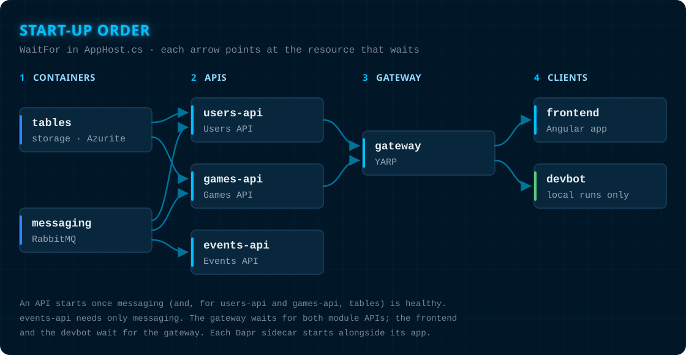

# Resource relations

A resource on its own does little. The value of the AppHost is in the relations between resources: which resource needs to know where another one is, and which resource must be ready before another one starts. Aspire has two tools for this, **references** and **`WaitFor`**, and Battleship uses both.

## References: connection details flow from one resource to another

When resource A references resource B, the AppHost hands A everything it needs to reach B, as environment variables, at start-up. You never type a host name, a port or a connection string. When B's port changes on the next run, A still finds it.

This app uses references in four ways.

**A connection string.** Both the Games API and the Users API reference the `tables` resource:

```csharp
var gamesApi = builder.AddProject<Projects.HexMaster_Battleship_Games_Api>(GatewayRoutes.GamesApi)
    // ...
    .WithReference(tables);
```

The API receives a connection string named `tables`. Inside the API, the Azure Tables client integration asks for it by that name, `builder.AddAzureTableServiceClient("tables")`, and gets a client that is already configured, with health checks and tracing.

**Service discovery.** The dev bot references the `gateway`. It then calls `https+http://gateway/`, and Aspire's service discovery resolves the name `gateway` to the gateway's real address.

**An endpoint as a plain value.** When a resource needs another resource's URL but cannot use service discovery, the AppHost passes the endpoint as an environment variable. The Angular dev server cannot read service discovery settings, so the `frontend` receives the gateway URL like this:

```csharp
var frontend = builder.AddJavaScriptApp("frontend", "../../../Frontend", "start:aspire")
    .WithHttpEndpoint(env: "PORT")
    .WithEnvironment("BACKEND_GATEWAY_URL", gateway.GetEndpoint("http"))
    .WaitFor(gateway);
```

It works the other way round as well: each module API receives the frontend's address in `Gateway__AllowedOrigins`, so its CORS policy allows exactly that origin for this run. Parameters travel the same way. The Users and Games APIs receive the `users-signing-key` parameter as `Users__Tokens__SigningKey`.

**A reference expression.** The Dapr pub/sub component needs the broker's address as `host:port`. The AppHost builds that string from the live `messaging` endpoint, so it is never written to a file:

```csharp
var messagingHostAndPort = ReferenceExpression.Create(
    $"{messagingEndpoint.Property(EndpointProperty.Host)}:{messagingEndpoint.Property(EndpointProperty.Port)}");
```

Each API's Dapr sidecar then references the `pubsub` component, and the Games API's sidecar also references `game-cleanup`. The APIs themselves reach RabbitMQ only through Dapr, so they do not reference `messaging`. See [Dapr](dapr.md).

## How a request and an event travel

The references above make one round trip possible: a player fires a shot, and both browsers see it.


The same flow, step by step:

1. **Browser to gateway.** The Angular app calls a relative URL such as `/api/games/K7Q2M9XA/shots`. An interceptor sends it to the gateway URL the AppHost gave the `frontend`.
2. **Gateway to the APIs.** YARP routes each first path segment to the API that owns it: `/users` to `hexmaster-battleship-users-api` and `/games` to `hexmaster-battleship-games-api`.
3. **API to pub/sub.** The Games API records the shot and publishes an integration event, such as `game.shot-fired.v1`, through its Dapr sidecar to the topic `integration-events` on the `pubsub` component, which runs on RabbitMQ. Today the Games API is the only publisher. The Users API has a sidecar with the same component, but publishes no events yet.
4. **Pub/sub to the Events API.** The sidecar of `hexmaster-battleship-events-api` receives the event from its subscription to `integration-events` and hands it to the Events API.
5. **Events API to the browser.** The Events API pushes the event over server-sent events to the browsers it targets. The browser opens this stream at `GET /events` directly on the Events API, not through the gateway.

## WaitFor: start-up order

A reference says where a resource is. `WaitFor` says when another resource may start: the waiting resource stays in the **Waiting** state on the dashboard until the resource it waits for is running and, if it has health checks, healthy.

```csharp
var usersApi = builder.AddProject<Projects.HexMaster_Battleship_Users_Api>(GatewayRoutes.UsersApi)
    // ...
    .WaitFor(messaging)
    .WaitFor(tables);
```



These are all the `WaitFor` relations in `AppHost.cs`:

| Resource | Waits for |
|---|---|
| `hexmaster-battleship-users-api` | `messaging`, `tables` |
| `hexmaster-battleship-games-api` | `messaging`, `tables` |
| `hexmaster-battleship-events-api` | `messaging` |
| `gateway` | `hexmaster-battleship-users-api`, `hexmaster-battleship-games-api` |
| `frontend` | `gateway` |
| `devbot` | `gateway` |

The result is a start-up in four stages: the containers, then the APIs, then the gateway, then the frontend and the dev bot. Without `WaitFor`, an API and its sidecar could start while RabbitMQ or the table storage emulator is still starting, and fail their first connections.

A reference and `WaitFor` are separate decisions. The APIs wait for `messaging` without referencing it, and the Events API is not behind the gateway, so the gateway does not wait for it.
